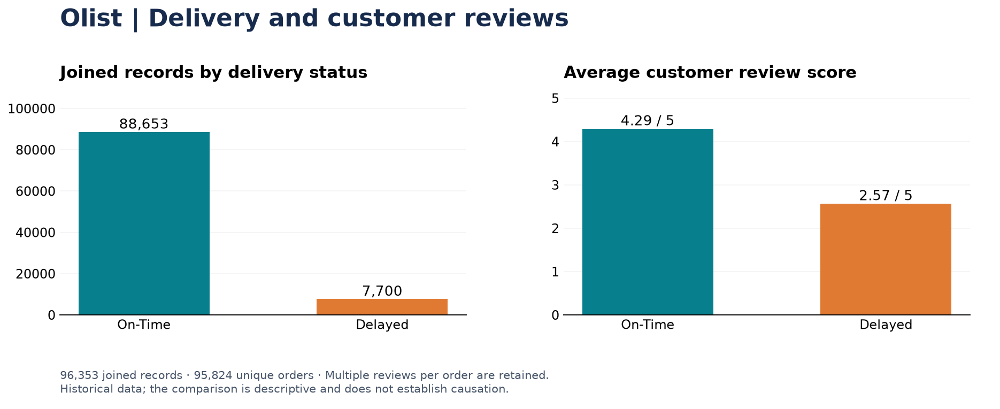
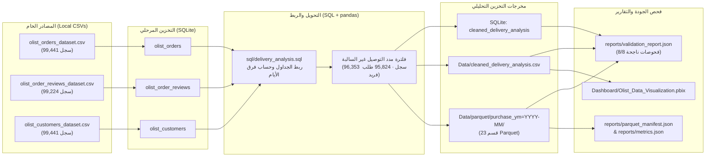

[English overview and setup instructions](README.md)

# 🚚 مشروع تحليل بيانات متجر Olist: خط أنابيب بيانات (ETL) وأثر تأخير التوصيل على تقييمات العملاء
### (Olist E-Commerce: Multi-Source ETL Pipeline & Delivery Delay Analysis)

**SQL · Python (pandas, PyArrow) · SQLite · Power BI**<br>
[English](README.md) · [الملف المهني](https://github.com/MohammadKhairJaradat) · [لوحة تحكم Power BI](Dashboard/Olist_Data_Visualization.pbix)

---

## 🎯 نظرة عامة وسؤال العمل الرئيسي (Overview & Business Question)

يركّز هذا المشروع على بناء **خط أنابيب بيانات محلي متكامل (Multi-Source ETL Pipeline)** للإجابة عن سؤال تحليلي محدد:
> **"كيف تختلف تقييمات العملاء (Review Scores) بين الشحنات التي وصلت في موعدها (On-Time) والشحنات المتأخرة (Delayed) في بيانات متجر Olist البرازيلي؟"**

يقوم خط الأنابيب (`run_pipeline.py`) باستيراد 3 جداول خام من بيانات Olist (**إجمالي 298,106 سجلًا خامًا**) إلى جداول مرحلية داخل قاعدة بيانات SQLite (`olist.db`)، ثم تنفيذ استعلام ربط وتحويل عبر SQL و`pandas` لإنتاج جدول تحليلي نظيف (**96,353 سجلًا بعد الربط تغطي 95,824 طلبًا فريدًا**)، وحفظ المخرجات في ثلاث صيغ متطابقة:
1. جدول تحليلي مفهرس داخل قاعدة بيانات **SQLite** (`cleaned_delivery_analysis`).
2. ملف **CSV** نظيف (`Data/cleaned_delivery_analysis.csv`) لتغذية لوحة Power BI ومفكرة Jupyter.
3. ملفات **Parquet مقسّمة حسب شهر الشراء** (`Data/parquet/purchase_ym=YYYY-MM/`) باستخدام مكتبة `PyArrow` (**23 قسمًا شهريًا**)، مع توليد تقرير فحص جودة البيانات ومطابقة المتاجر تلقائيًا في `reports/validation_report.json`.



---

## 🏗️ معمارية خط الأنابيب (Pipeline Architecture)



---

## 📥 مصادر البيانات (Data Sources)

المصدر: [Brazilian E-Commerce Public Dataset by Olist](https://www.kaggle.com/datasets/olistbr/brazilian-ecommerce) (مرخّص تحت CC BY-NC-SA 4.0). جميع عمليات الاستخراج والتخزين تعمل محليًا.

| الملف المصدر (`Data/`) | جدول SQLite المرحلي | عدد السجلات | مفتاح الربط |
|---|---|---:|---|
| `olist_orders_dataset.csv` | `olist_orders` | 99,441 | `order_id`, `customer_id` |
| `olist_order_reviews_dataset.csv` | `olist_order_reviews` | 99,224 | `order_id` (`review_id`) |
| `olist_customers_dataset.csv` | `olist_customers` | 99,441 | `customer_id` |
| **الإجمالي المرحلي** | **3 جداول** | **298,106** | |

> **ملاحظة:** تم استثناء ملفات CSV الخام الكبيرة (`Data/olist_*.csv`) وملفات `olist.db` و`Data/parquet/` عبر `.gitignore` للحفاظ على خفة المستودع، بينما تم تضمين الملف التحليلي النظيف `Data/cleaned_delivery_analysis.csv` بحيث يمكن تشغيل خط الأنابيب مباشرة عبر الخيار `--from-cleaned` دون الحاجة لتنزيل الملفات الخام من Kaggle.

---

## ✅ فحوصات جودة البيانات ومطابقة المتاجر (Data Quality Checks)

يقوم السكربت `run_pipeline.py` بتشغيل **8 فحوصات آلية** وحفظ نتائجها في [`reports/validation_report.json`](reports/validation_report.json):

| اسم الفحص | القاعدة التحقق منها | النتيجة الفعلية |
|---|---|---|
| `required_columns_present` | وجود الأعمدة التحليلية العشرة المطلوبة بالترتيب | 10/10 أعمدة موجودة |
| `no_null_critical_fields` | عدم وجود قيم مفقودة (Nulls) في جميع الأعمدة العشرة | `0` قيم مفقودة |
| `review_score_range_1_to_5` | وقوع جميع تقييمات العملاء ضمن النطاق `1..5` | الحد الأدنى `1` والأقصى `5` (`0` خارج النطاق) |
| `delivery_date_not_before_purchase_date` | مدة التوصيل الفعلي غير سالبة وتاريخ التسليم لا يسبق الشراء | `0` مخالفات (المدى من `0.5` إلى `208.4` يوم) |
| `valid_delivery_status_domain` | اقتصار حالة التوصيل على `On-Time` و`Delayed` | مطابق تمامًا |
| `order_delivery_status_consistent_across_reviews` | ثبات حالة التوصيل للطلب الواحد عند تعدد تقييماته | `525` طلبًا متعدد التقييمات (`529` سجلًا إضافيًا)، `0` تعارض |
| `monthly_partition_coverage_audit` | تدقيق تغطية أشهر الشراء بين `2016-09` و`2018-08` (24 شهرًا) | `23` قسمًا شهريًا؛ رصد الفجوة المعروفة في المصدر لشهر `2016-11` (`0` طلبات مسلّمة) |
| `cross_store_reconciliation_sqlite_csv_parquet` | تطابق أعداد السجلات والطلبات ومتوسطات التقييم بين SQLite وCSV وParquet | تطابق تام: `96,353` سجلًا و`95,824` طلبًا فريدًا في المتاجر الثلاثة |

---

## 📊 أهم نتائج التحليل (Key Findings)

بعد تحليل **96,353 سجلًا بعد الربط تمثل 95,824 طلبًا فريدًا** خلال الفترة من **15 سبتمبر 2016 إلى 29 أغسطس 2018**:

| حالة التوصيل (Delivery Status) | عدد السجلات (Joined Records) | الطلبات الفريدة (Unique Orders) | النسبة المئوية (%) | متوسط التقييم (Avg Review) | التقييم الوسيط (Median) |
|---|---:|---:|---:|---:|---:|
| **في الموعد (On-Time)** | 88,653 | 88,163 | 92.01% | **4.29 / 5.0** | 5.0 ⭐ |
| **متأخر (Delayed)** | 7,700 | 7,661 | 7.99% | **2.57 / 5.0** | 2.0 ⭐ |

* **فرق التقييم:** الطلبات المتأخرة تسجل متوسط تقييم أقل بمقدار **1.73 نقطة** (أقل بنحو **40%** من الطلبات المسلّمة في الموعد).
* **وحدة التحليل:** قد يحتوي الطلب الواحد على أكثر من تقييم؛ لذلك تبلغ نسبة التأخير على مستوى السجلات المربوطة **7.99%** (`7,700 / 96,353`) وعلى مستوى الطلبات الفريدة **8.00%** (`7,661 / 95,824`). هذه المقارنة وصفية ولا تثبت علاقة سببية مباشرة.

---

## 🚀 كيفية تشغيل المشروع محلياً (How to Run)

```powershell
git clone https://github.com/MohammadKhairJaradat/Olist_Data_Analysis.git
cd Olist_Data_Analysis

# 1. إنشاء بيئة افتراضية محلية وتثبيت المكتبات
uv venv --python 3.12 .venv
uv pip install --python .venv\Scripts\python.exe -r requirements.txt

# 2. تشغيل خط أنابيب ETL الكامل (من الملفات الخام إن وجدت أو من الملف النظيف المرفق)
.venv\Scripts\python.exe run_pipeline.py

# أو تحديد الوضع صراحةً:
.venv\Scripts\python.exe run_pipeline.py --from-raw
.venv\Scripts\python.exe run_pipeline.py --from-cleaned

# 3. تشغيل اختبارات التحقق (pytest)
.venv\Scripts\python.exe -m pytest -v

# 4. تشغيل السكربتات المستقلة الأصلية
.venv\Scripts\python.exe load_to_sqlite.py
.venv\Scripts\python.exe summarize_results.py
```

---

## 📂 هيكل المشروع (Project Structure)

```text
Olist_Data_Analysis/
├── run_pipeline.py                    # خط أنابيب ETL الرئيسي (SQLite + CSV + Parquet + Validation)
├── load_to_sqlite.py                  # سكربت تحميل ملفات CSV الخام إلى SQLite
├── summarize_results.py               # سكربت حساب المؤشرات وحفظ الرسم التلخيصي
├── sql/
│   └── delivery_analysis.sql          # استعلام SQL لربط الطلبات والتقييمات والعملاء
├── Data/
│   ├── cleaned_delivery_analysis.csv  # الملف التحليلي النظيف (96,353 سجل)
│   └── parquet/                       # مخرجات Parquet المقسّمة شهرياً (purchase_ym=YYYY-MM/)
├── reports/
│   ├── delivery_review_summary.png    # الرسم البياني التلخيصي للنتائج
│   ├── metrics.json                   # ملخص المؤشرات الإحصائية
│   ├── parquet_manifest.json          # بيانات وصفية لأقسام Parquet الـ 23
│   └── validation_report.json         # تقرير فحص جودة البيانات ومطابقة المتاجر
├── tests/
│   └── test_pipeline.py               # اختبارات pytest الخفيفة لخط الأنابيب
├── notebooks/
│   └── delivery_analysis.ipynb        # مفكرة Jupyter للتحليل الاستكشافي
└── Dashboard/
    └── Olist_Data_Visualization.pbix  # لوحة تحكم Power BI التفاعلية
```

---

## 💡 ماذا تعلمت والخطوات القادمة (What I Learned & Next Steps)

- بناء خط أنابيب ETL متعدد المصادر يربط بين **SQLite** و**pandas** ومخرجات **Parquet المقسّمة زمنيًا (PyArrow)**.
- تطبيق فحوصات جودة البيانات الآلية ومطابقة الأعداد والمتوسطات بين قواعد البيانات العلائقية والملفات العمودية (Cross-store reconciliation)، ورصد فجوات التغطية الزمنية (`2016-11`).
- **الخطوة القادمة:** دمج بيانات المسافات الجغرافية (`olist_geolocation_dataset.csv`) وتفاصيل عناصر الطلب (`olist_order_items_dataset.csv`) لتحليل أثر المسافة بين البائع والعميل على احتمالية التأخير.

## التواصل (Contact)

للاستفسار عن المشروع: [محمد خير جرادات](mailto:mohammad.sameer.jaradat@gmail.com) · [الملف المهني](https://github.com/MohammadKhairJaradat) · [السيرة الذاتية (CV)](https://github.com/MohammadKhairJaradat/MohammadKhairJaradat/blob/main/Mohammad_Khair_Jaradat_CV.pdf)
