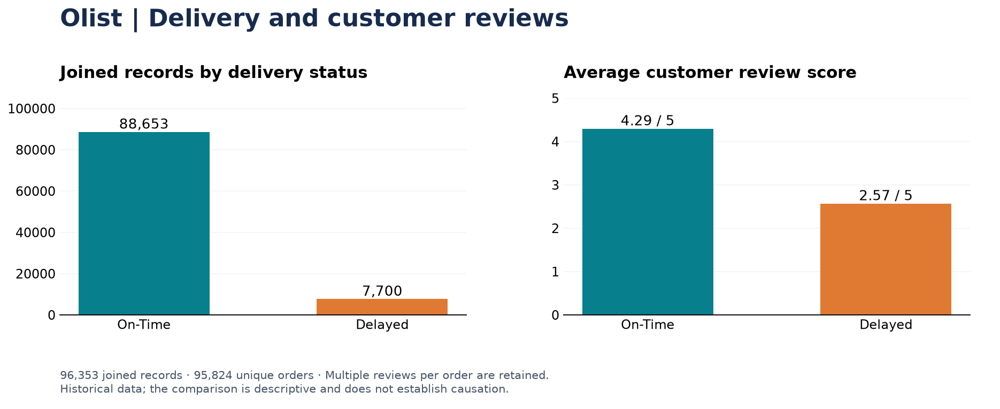
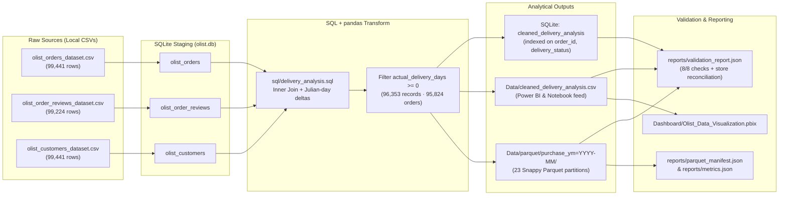

# Olist Delivery & Customer Reviews — Multi-Source ETL Pipeline

**SQL · Python (pandas, PyArrow) · SQLite · Power BI**<br>
[العربية](README.ar.md) · [Portfolio](https://github.com/MohammadKhairJaradat) · [Power BI Dashboard](Dashboard/Olist_Data_Visualization.pbix)

## Overview

This project builds a local, reproducible **multi-source ETL pipeline** and analytical workflow around one focused question: **How do customer review scores differ between on-time and delayed deliveries in the Olist Brazilian E-Commerce dataset?**

The pipeline ingests three raw Olist relational CSV tables (**298,106 total staged rows**) into a local SQLite database (`olist.db`), joins and transforms delivered orders with customer states and order reviews via SQL and pandas, writes the cleaned analytical dataset to **SQLite**, **CSV**, and a **monthly-partitioned PyArrow Parquet dataset** (`Data/parquet/purchase_ym=YYYY-MM/`), and executes **8 automated data-quality & cross-store reconciliation checks** (`reports/validation_report.json`) before refreshing the summary chart and Power BI feed.



## Architecture



## Data Sources

Source: [Brazilian E-Commerce Public Dataset by Olist](https://www.kaggle.com/datasets/olistbr/brazilian-ecommerce) (CC BY-NC-SA 4.0). All ingestion and storage run locally on SQLite, CSV, and local filesystem Parquet partitions.

| Source file (`Data/`) | SQLite staging table | Staged rows | Primary / join key |
|---|---|---:|---|
| `olist_orders_dataset.csv` | `olist_orders` | 99,441 | `order_id`, `customer_id` |
| `olist_order_reviews_dataset.csv` | `olist_order_reviews` | 99,224 | `order_id` (`review_id`) |
| `olist_customers_dataset.csv` | `olist_customers` | 99,441 | `customer_id` |
| **Total staged** | **3 staging tables** | **298,106** | |

> **Note:** The raw Kaggle CSVs (`Data/olist_*.csv`) and the generated SQLite/Parquet files are git-ignored to keep the repository lightweight. The cleaned analytical CSV (`Data/cleaned_delivery_analysis.csv`) is committed so the pipeline (`python run_pipeline.py --from-cleaned`), validation suite, partitioned Parquet export, and Power BI dashboard work immediately after cloning without downloading the raw Kaggle files.

## Pipeline Steps (`run_pipeline.py`)

1. **Extract & Stage (`extract_and_stage`)** — Loads the 3 raw Olist CSVs into SQLite staging tables (`olist_orders`, `olist_order_reviews`, `olist_customers`), or falls back to staging from `Data/cleaned_delivery_analysis.csv` when run with `--from-cleaned` (or `--mode auto` without raw CSVs).
2. **Transform (`transform_delivery_data`)** — Executes [`sql/delivery_analysis.sql`](sql/delivery_analysis.sql) inside SQLite to join delivered orders (`order_status = 'delivered'`) with non-null actual and estimated delivery dates against customer state and review scores, computes `actual_delivery_days` and `delay_days` using `JULIANDAY`, classifies rows into `On-Time` vs `Delayed`, filters `actual_delivery_days >= 0`, and writes both `Data/cleaned_delivery_analysis.csv` and the indexed SQLite table `cleaned_delivery_analysis`.
3. **Partitioned Parquet Export (`write_partitioned_parquet`)** — Derives `purchase_ym` (`YYYY-MM`) from `purchase_date` and writes a Snappy-compressed partitioned Parquet dataset to `Data/parquet/purchase_ym=YYYY-MM/` via `pyarrow.parquet`, saving partition-level row counts, order counts, delay counts, and byte sizes to [`reports/parquet_manifest.json`](reports/parquet_manifest.json) (**23 monthly partitions, 96,353 rows, ~7.28 MB**).
4. **Data Quality & Reconciliation (`validate_pipeline`)** — Runs 8 automated checks and writes [`reports/validation_report.json`](reports/validation_report.json).
5. **Summary & Visualization (`summarize_results.py`)** — Recomputes group KPIs into [`reports/metrics.json`](reports/metrics.json) and renders [`reports/delivery_review_summary.png`](reports/delivery_review_summary.png).

## Data Quality & Validation Checks

Every pipeline run writes [`reports/validation_report.json`](reports/validation_report.json) verifying **8/8 checks**:

| Check name | Rule verified | Verified result |
|---|---|---|
| `required_columns_present` | All 10 analytical columns exist in exact order | 10/10 present (`missing_columns: []`) |
| `no_null_critical_fields` | Zero nulls across IDs, state, review score, dates, and durations | `0` nulls across all 10 columns |
| `review_score_range_1_to_5` | `review_score` is an integer between `1` and `5` | `min=1`, `max=5`, `0` out-of-range rows |
| `delivery_date_not_before_purchase_date` | `actual_delivery_days >= 0` and `actual_delivery_date >= purchase_date` | `0` violations (`0.5` to `208.4` days) |
| `valid_delivery_status_domain` | `delivery_status` strictly in `{'On-Time', 'Delayed'}` | Exact match |
| `order_delivery_status_consistent_across_reviews` | Multi-review orders never have conflicting `delivery_status` | `525` multi-review orders (`529` extra rows), `0` conflicts |
| `monthly_partition_coverage_audit` | Audits monthly partitions across `2016-09..2018-08` (24 calendar months) | `23` active partitions; flags known upstream gap `2016-11` (`0` delivered orders) |
| `cross_store_reconciliation_sqlite_csv_parquet` | Row counts, unique orders, status split, and mean reviews agree across SQLite, CSV, and Parquet | `96,353` rows & `95,824` unique orders across all 3 stores (`On-Time=88,653`, `Delayed=7,700`) |

## Results & Findings

The cleaned dataset contains **96,353 joined order-review records covering 95,824 unique delivered orders**, with purchase dates from **2016-09-15 to 2018-08-29**.

| Delivery status | Joined records | Unique orders | Share of records | Average review | Median review |
|---|---:|---:|---:|---:|---:|
| **On-Time** | 88,653 | 88,163 | 92.01% | **4.29 / 5** | 5.0 |
| **Delayed** | 7,700 | 7,661 | 7.99% | **2.57 / 5** | 2.0 |

- Delayed deliveries have a **1.73-point lower average review score** (~40% lower than on-time deliveries: `2.57` vs `4.29`).
- **Unit of analysis:** An order in Olist can have multiple review records (`525` delivered orders have >1 review, accounting for `529` additional joined rows). The SQL join preserves all review rows; the unique-order delay rate is **8.00%** (`7,661 / 95,824`), while the record-weighted delay rate is **7.99%** (`7,700 / 96,353`).
- **Operational takeaway:** Prioritize delay monitoring by customer state and purchase month (especially peak delay months such as `2017-11`, `2018-02`, and `2018-03` visible in `reports/parquet_manifest.json`) and proactively notify customers when shipments approach their estimated delivery date. This descriptive comparison does not establish causation or measure post-intervention impact.

## How to Run

### 1. Environment Setup (Local `.venv`)

```powershell
git clone https://github.com/MohammadKhairJaradat/Olist_Data_Analysis.git
cd Olist_Data_Analysis

# Create an isolated virtual environment (uv or standard venv)
uv venv --python 3.12 .venv
uv pip install --python .venv\Scripts\python.exe -r requirements.txt
```

### 2. Run the End-to-End ETL Pipeline

- **With raw Kaggle CSVs in `Data/`** (`olist_orders_dataset.csv`, `olist_order_reviews_dataset.csv`, `olist_customers_dataset.csv`):
  ```powershell
  .venv\Scripts\python.exe run_pipeline.py --from-raw
  ```
- **Without downloading raw CSVs** (uses the included `Data/cleaned_delivery_analysis.csv` to build SQLite analytical tables, partitioned Parquet, validation report, and summary chart):
  ```powershell
  .venv\Scripts\python.exe run_pipeline.py --from-cleaned
  ```
- **Auto mode** (uses raw CSVs if present in `Data/`, otherwise falls back to `--from-cleaned`):
  ```powershell
  .venv\Scripts\python.exe run_pipeline.py
  ```

### 3. Run Standalone Scripts, Notebook, Power BI, and Tests

```powershell
# Run the test suite (schema, metrics, Parquet manifest, fallback pipeline)
.venv\Scripts\python.exe -m pytest -v

# Standalone legacy scripts (preserved)
.venv\Scripts\python.exe load_to_sqlite.py
.venv\Scripts\python.exe summarize_results.py

# Exploratory notebook
.venv\Scripts\python.exe -m jupyter notebook notebooks/delivery_analysis.ipynb
```

To inspect the interactive dashboard, open [`Dashboard/Olist_Data_Visualization.pbix`](Dashboard/Olist_Data_Visualization.pbix) in **Power BI Desktop** (repoint its data source path to your local `Data/cleaned_delivery_analysis.csv` if refreshing).

## Project Structure

```text
Olist_Data_Analysis/
├── run_pipeline.py                    # End-to-end CLI ETL pipeline (SQLite + CSV + Parquet + QA)
├── load_to_sqlite.py                  # Standalone loader for the 3 raw Olist CSVs into olist.db
├── summarize_results.py               # Recomputes KPIs (metrics.json) and summary chart
├── sql/
│   └── delivery_analysis.sql          # SQL join across orders, reviews, and customers
├── Data/
│   ├── cleaned_delivery_analysis.csv  # Cleaned analytical dataset (96,353 rows · 95,824 orders)
│   └── parquet/                       # Partitioned Parquet output (purchase_ym=YYYY-MM/, git-ignored)
├── reports/
│   ├── delivery_review_summary.png    # Reproducible Python summary chart
│   ├── metrics.json                   # Group KPIs and delay rates
│   ├── parquet_manifest.json          # Partition metadata (23 monthly partitions, row/order counts)
│   └── validation_report.json         # Automated data-quality & cross-store reconciliation report
├── tests/
│   └── test_pipeline.py               # Light pytest suite for schema, QA report, and pipeline modes
├── notebooks/
│   └── delivery_analysis.ipynb        # Exploratory analysis, distributions, and SQL walkthrough
├── Dashboard/
│   └── Olist_Data_Visualization.pbix  # One-page interactive Power BI dashboard
├── requirements.txt
├── README.md
└── README.ar.md
```

## What I Learned & Next Steps

- **Multi-source relational staging & reconciliation:** Staging separate CSV entities (`orders`, `reviews`, `customers`) into SQLite and verifying that row counts, unique orders, and group aggregates match across SQLite, CSV, and partitioned Parquet stores.
- **Handling grain & one-to-many joins:** Accounting for orders with multiple reviews (`96,353` joined rows vs `95,824` unique orders) and asserting that order-level attributes (`delivery_status`) never conflict across review rows.
- **Partitioned columnar storage & coverage auditing:** Partitioning analytical output by `purchase_ym` (`YYYY-MM`) with PyArrow and automatically detecting calendar coverage gaps (`2016-11`).
- **Next steps:** Add seller/carrier distance features from `olist_geolocation_dataset.csv` and `olist_order_items_dataset.csv` to separate last-mile distance effects from carrier delay effects.

## Contact

[Email Mohammad Khair Jaradat](mailto:mohammad.sameer.jaradat@gmail.com) · [GitHub profile](https://github.com/MohammadKhairJaradat) · [CV](https://github.com/MohammadKhairJaradat/MohammadKhairJaradat/blob/main/Mohammad_Khair_Jaradat_CV.pdf)
