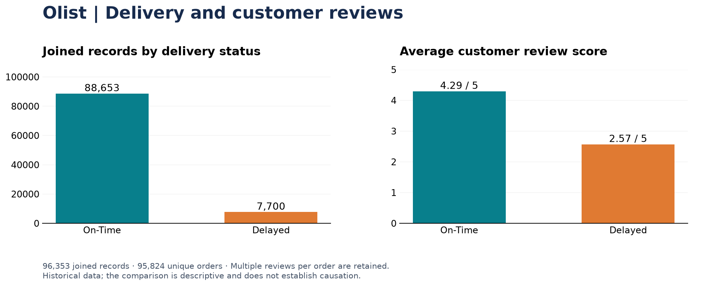

# Olist Delivery and Customer Reviews

**SQL · Python · Power BI**<br>
[العربية](README.ar.md) · [Portfolio](https://github.com/MohammadKhairJaradat) · [Power BI file](Dashboard/Olist_Data_Visualization.pbix)

A focused analysis of one question: **How do customer review scores differ between on-time and delayed deliveries?** This project joins the data in SQLite, checks and analyzes it with pandas, and presents the delivery KPIs in Power BI.



## Findings

The included analysis contains **96,353 joined records covering 95,824 unique orders**, with purchase dates from September 2016 to August 2018.

| Delivery status | Joined records | Share of records | Average review | Median review |
|---|---:|---:|---:|---:|
| On-time | 88,653 | 92.01% | 4.29 / 5 | 5 |
| Delayed | 7,700 | 7.99% | 2.57 / 5 | 2 |

The delayed group has a **1.73-point lower average review** (about 40% below the on-time group). This suggests prioritizing investigation of delivery delays and clearer customer updates. It does not establish causation, measure churn, or show the effect of an implemented intervention.

**Unit of analysis:** an order can have multiple review records. The SQL join preserves those rows, so the percentages and review averages above are weighted by joined records. They are not equal-weight order-level estimates. The unique-order delay rate is approximately **8.00%** (7,661 / 95,824).

## Recommendations

- Monitor delayed-delivery segments by customer state and purchase period to prioritize further investigation.
- Review delivery estimates and improve customer updates when a delay is expected.

These are proposed operational actions. This project does not measure whether implementing them reduces delays or increases review scores.

## View the outputs

- Open [the original Power BI dashboard](Dashboard/Olist_Data_Visualization.pbix) in Power BI Desktop. To refresh it, repoint its data source to your local `Data/cleaned_delivery_analysis.csv`.
- Read [the notebook](notebooks/delivery_analysis.ipynb) for SQL extraction, cleaning, comparisons, and charts.
- Use [the included cleaned CSV](Data/cleaned_delivery_analysis.csv) to explore the results without downloading the original dataset.
- The preview above is a **Python results summary**, separate from the Power BI dashboard.

## Run from the original data

Download the [Brazilian E-Commerce Public Dataset by Olist](https://www.kaggle.com/datasets/olistbr/brazilian-ecommerce) and place these three files in `Data/`:

```text
olist_orders_dataset.csv
olist_order_reviews_dataset.csv
olist_customers_dataset.csv
```

The source files are not included in this repository. Keep the filenames unchanged.

```bash
git clone https://github.com/MohammadKhairJaradat/Olist_Data_Analysis.git
cd Olist_Data_Analysis
python -m pip install -r requirements.txt
python load_to_sqlite.py
python -m jupyter notebook notebooks/delivery_analysis.ipynb
```

Run the notebook cells in order. The loader creates `olist.db`; the notebook executes [delivery_analysis.sql](sql/delivery_analysis.sql), removes negative delivery durations, and exports the cleaned CSV. It supports a notebook started from the project root or the `notebooks` folder.

To regenerate the preview and verify the published metrics using the included cleaned CSV:

```bash
python summarize_results.py
```

## Files

| Path | Purpose |
|---|---|
| `load_to_sqlite.py` | Load the three required source CSVs into SQLite |
| `sql/delivery_analysis.sql` | Join delivered orders, customers and reviews; derive delivery status |
| `notebooks/delivery_analysis.ipynb` | Cleaning, descriptive analysis and export |
| `summarize_results.py` | Recalculate row/order metrics and save a results preview |
| `reports/` | Reproducible summary chart and metrics |
| `Data/cleaned_delivery_analysis.csv` | Included analysis-ready records |
| `Dashboard/Olist_Data_Visualization.pbix` | Original one-page Power BI dashboard |

## Scope and limitations

- Delivered orders with available delivery and estimated dates, and matching customer/review records only.
- The source is historical Brazilian e-commerce data; results do not describe current performance.
- Multiple reviews per order affect row-level weighting. Delivery times and review scores can also be affected by factors outside this analysis.
- Recommendations are proposed actions; business impact has not been measured.

Source: [Olist dataset](https://www.kaggle.com/datasets/olistbr/brazilian-ecommerce), distributed under CC BY-NC-SA 4.0. This is an independent educational project. The original data remains attributable to its providers.

## Contact

[Email Mohammad Khair Jaradat](mailto:mohammad.sameer.jaradat@gmail.com) · [GitHub profile](https://github.com/MohammadKhairJaradat) · [CV](https://github.com/MohammadKhairJaradat/MohammadKhairJaradat/blob/main/Mohammad_Khair_Jaradat_CV.pdf)
